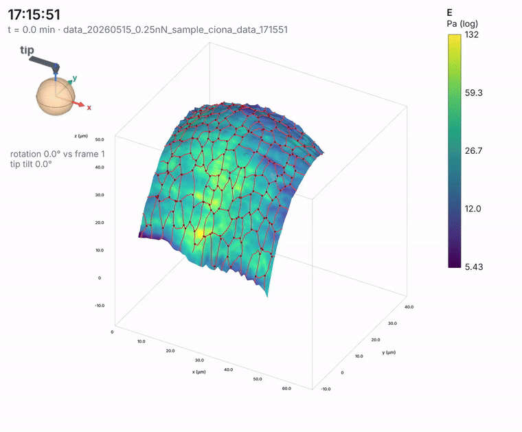
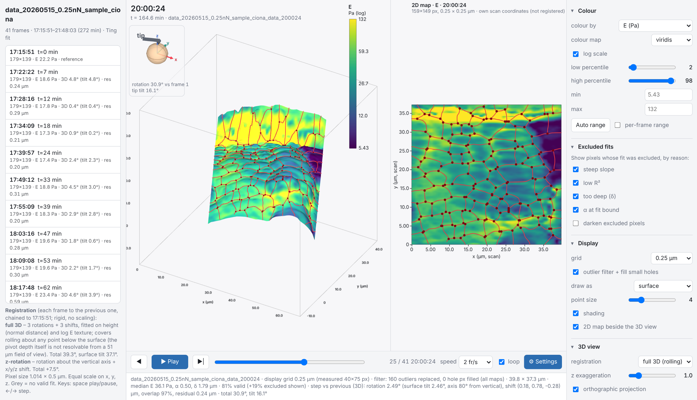

# AFM-FV-Ting-pipeline

Viscoelastic analysis of AFM force-volume maps and time-lapses of living specimens: a **Ting (Lee–Radok) power-law fit** of every force curve, **adhesion** properties from the retract curves, **cell segmentation and tracking** on the registered 3D surface, and a **self-contained HTML time-lapse viewer**.

<p align="center">
  <a href="media/demo.mp4"></a><br>
  <sub>Young's modulus E(1 ms) on the registered embryo surface, 41 frames over 4.5 h (8 frames/s, cross-faded, exported from the viewer), with cell outlines, junctions and the orientation inset (embryo axes and cantilever tip). Click for the full-resolution <a href="media/demo.mp4">MP4</a>.</sub>
</p>

## What it does

| step | script | output |
|---|---|---|
| 1 | `afm_ting_pipeline.py` | Ting fit per curve: E(t) = E₁ (t/t₀)^−α, fitted contact point, slope (normal-frame) correction, hydrodynamic drag correction, E at reference times (1, 2, 10 ms), model variants, adhesion, quality flags → one `.npz` per map + quick-look PNG |
| 2 | `extract_topo_E.py` | one `.npy` per map and property (topography, E, α, δ, adhesion, peak force and load-normalised adhesion, every model variant, exclusion mask) + `pixels.json` |
| 3 | `segment_cells.py` | multi-channel cell segmentation, 3D rigid registration of the frames, tracking, division detection → cell table, tracks, label maps |
| 4 | `build_timelapse_viewer.py` | one HTML file (data, three.js and the page built in; works offline) |

All four read one parameter file, [`afm_pipeline.toml`](afm_pipeline.toml), grouped as: AFM / probe / acquisition / preprocessing / fit / quality / clustering / adhesion / export / registration / segmentation / tracking / viewer. Values set to `"auto"` are derived from the data (block size, baseline window, scan size, registration shift limit, …). Command-line options override the file.

## Try it

**Live demo:** [stefanbaar.github.io/AFM-FV-Ting-pipeline/demo/ciona_timelapse_viewer.html](https://stefanbaar.github.io/AFM-FV-Ting-pipeline/demo/ciona_timelapse_viewer.html) – the full 41-frame Ciona time-lapse in the viewer (one self-contained 10 MB HTML file; nothing to install).

Offline: download [`demo/ciona_timelapse_viewer.html`](demo/ciona_timelapse_viewer.html) (*Download raw file*) and open it in Chrome, Edge, Safari or Firefox.

## Time-lapse viewer



- Settings in a collapsible sidebar on the right (Colour, Excluded fits, Display, 3D view, Segmentation, Export); hidden by default, opened with **⚙ Settings**.
- 3D surface, registered frame-to-frame (full 3D rolling, z-rotation only, or raw), with a 2D map in scan coordinates next to it.
- Colour by E, α, δ, topography, every adhesion property, every model variant (E at 1 ms / 2 ms / 10 ms, E₁, lab contact point, squeeze-film, elastic, depth ratio) or cell tracks.
- Display upsampling (0.5 / 0.25 µm, bicubic), isolated-outlier filter and hole filling, excluded pixels shown or darkened.
- Cell outlines as smooth vectors with junctions, or pixel edges.
- **Orientation inset**: a sphere with the embryo's body axes and the cantilever tip, the tip's path over the embryo surface so far (red), and the total rotation and tip tilt relative to frame 1.
- **Export**: PNG, PDF or MP4 (all frames, H.264; optional smooth 30/60 fps video with cross-fades and a continuously moving orientation inset), of the 3D view, the 2D map or both side by side, at 1280–3840 px, with a white background. MP4 encoding runs in the browser (WebCodecs; current Chrome, Edge, Safari or Firefox).

## Installation

```bash
git clone https://github.com/StefanBaar/AFM-FV-Ting-pipeline.git
cd AFM-FV-Ting-pipeline
pip install -r requirements.txt
```

Python ≥ 3.9. Python ≥ 3.11 reads the TOML config natively; older versions use `tomli` if installed, otherwise a built-in reader.

## Input data

```
data_20260515_0.25nN/            any root
  sample_ciona/
    data_171551/                 one map; the name ends in HHMMSS (start time) for time-lapses
      config.txt                 written by the instrument (scan size, pixels, speed, …)
      ForceCurve/
        ForceCurve_00000.lvm     one force curve per pixel, numbered in acquisition order
        ForceCurve_00001.lvm
        ...
    data_172222/
    ...
```

A data set is any folder with `config.txt` and `ForceCurve_<n>.lvm` files (in `ForceCurve/` or directly in the folder). Instrument constants that `config.txt` does not contain – **InvOLS, spring constant k, piezo sensitivities, sampling interval, probe radius** – go into the `[afm]` and `[probe]` sections of `afm_pipeline.toml`.

## Quick start

```bash
python afm_ting_pipeline.py data_20260515_0.25nN -o results --config afm_pipeline.toml   # 1 fit
python extract_topo_E.py   results -o maps --config afm_pipeline.toml                    # 2 maps
python segment_cells.py    maps    -o seg  --config afm_pipeline.toml                    # 3 cells (time-lapse)
python build_timelapse_viewer.py maps -o viewer.html --config afm_pipeline.toml          # 4 viewer
```

Steps 1–2 are enough for single maps. `python <script>.py -h` lists every option.

## Model notes

- **Fit**: exact Sneddon sphere contact, Ting/Lee–Radok hereditary integral with a power-law relaxation kernel; E₁ solved linearly, (α, contact point) by bounded least squares; approach and retract fitted together.
- **Recommended output**: `E_at_1ms_Pa` from the main fit (fitted contact point, slope-corrected). E₁ at t₀ = 1 s extrapolates far outside the measured time window and is not recommended for comparisons.
- **α** is best used as a relative quantity: a pre-contact squeeze-film "toe" biases it upward by a few hundredths (larger on softer regions). The `squeeze` variant models the toe explicitly as a check.
- Details, derivations and tests: [`docs/`](docs/).

## Documentation

LaTeX (Beamer) slides with sources, figures and the scripts that made them:

| | |
|---|---|
| [`docs/howto/howto_pipeline.pdf`](docs/howto/howto_pipeline.pdf) | installation, input data, config file, the four steps, outputs, troubleshooting |
| [`docs/ting/ting_fitting.pdf`](docs/ting/ting_fitting.pdf) | the Ting fit and every parameter |
| [`docs/variants/model_variants.pdf`](docs/variants/model_variants.pdf) | contact-point, toe and reference-time variants; effect on E, α, contrast and the E–α relationship |
| [`docs/adhesion/adhesion_properties.pdf`](docs/adhesion/adhesion_properties.pdf) | every adhesion property on the retract curve |
| [`docs/clustering/multiparam_clustering.pdf`](docs/clustering/multiparam_clustering.pdf) | multi-parameter clustering of E, α, δ and adhesion; which parameters are independent; cell identity; prior work |
| [`docs/segmentation/segmentation_tracking.pdf`](docs/segmentation/segmentation_tracking.pdf) | segmentation, registration and tracking, with the math and worked examples |

## Third-party code

The viewer embeds [three.js](https://threejs.org) r128 (MIT) and [mp4-muxer](https://github.com/Vanilagy/mp4-muxer) 5.2.2 (MIT).
